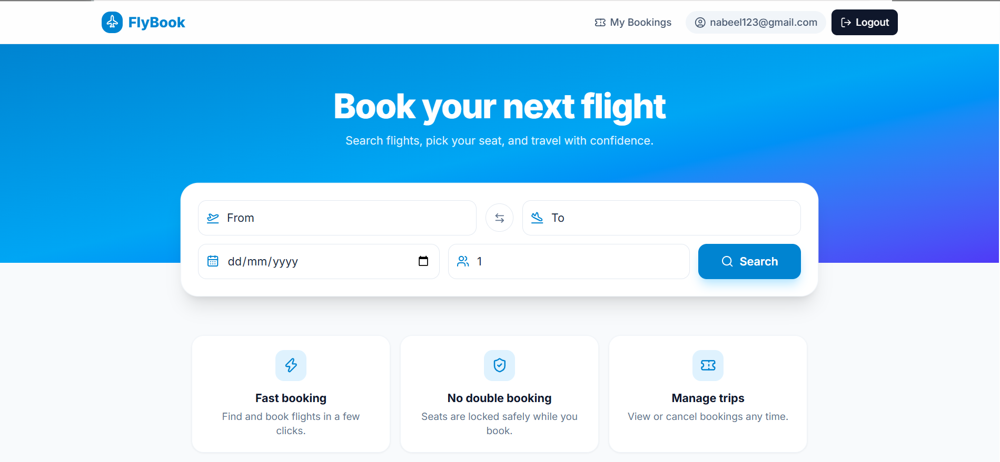
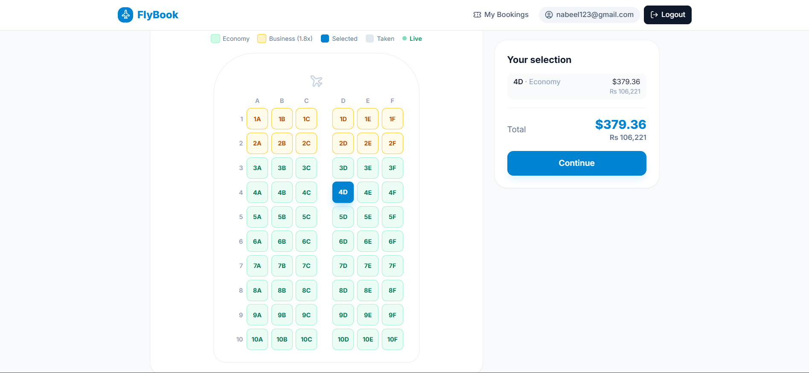
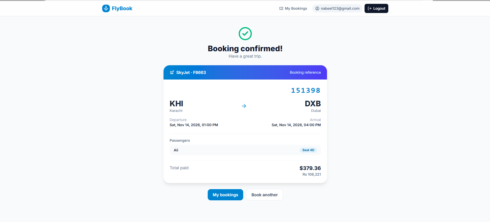

#  FlyBook: Flight Booking App

A full-stack flight booking app built with **React** and **Supabase**. Search flights, pick seats on a live seat map, book tickets, and manage bookings.

## Features

- Email signup and login (Supabase Auth)
- Flight search by route and date, with sorting (cheapest, fastest, earliest)
- Live seat map: seats taken by other users update instantly (Supabase Realtime)
- Economy and business seats with different pricing
- Prices shown in USD and PKR
- Passenger details form with validation
- Atomic booking with double-booking protection
- Booking confirmation with a 6-character PNR
- My Bookings page with cancellation (seats are released)

## Tech stack

- **Frontend:** React (Vite), Tailwind CSS, React Router, React Hook Form, lucide-react
- **Backend:** Supabase (PostgreSQL, Auth, Realtime, Row Level Security)

## How double booking is prevented

Booking runs inside one Postgres function, `book_seats`. It locks the requested seat rows with `SELECT ... FOR UPDATE`, checks that all of them are still available, then creates the booking, adds the passengers, and marks the seats as booked, all in a single transaction. If two users pick the same seat, the second one waits for the lock, then fails with a clear error. A unique constraint on `(flight_id, seat_number)` adds a second safety net.

## Security

- Row Level Security: users can read only their own bookings and passengers.
- Writes go through `security definer` functions that use `auth.uid()`, so the client cannot modify seats or bookings directly.

## Database

Tables: `airports`, `flights`, `flight_seats`, `bookings`, `passengers`.
Functions: `book_seats`, `cancel_booking`.

## Screenshots





## Run locally

```bash
git clone https://github.com/nabeel-456/fly-book.git
cd fly-book
npm install
```

Create a `.env` file in the project root:

```
VITE_SUPABASE_URL=https://your-project-id.supabase.co
VITE_SUPABASE_ANON_KEY=your-publishable-key
```

Then run:

```bash
npm run dev
```

## Notes

- Payment is mocked (no real payment provider).
- Flight data is seeded for demo purposes.
- Email confirmation is disabled for easy testing.

## Future improvements

- Real payments with Stripe
- Aircraft-specific seat layouts
- Round-trip and multi-city search
- Email confirmations and PDF e-tickets